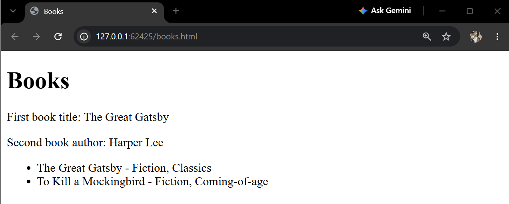
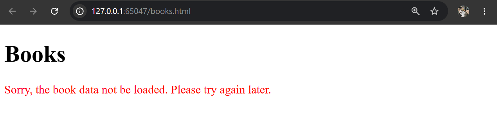
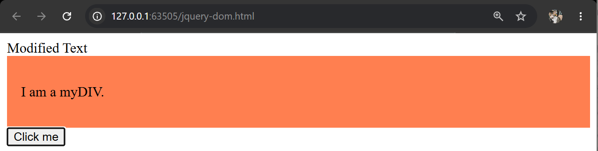
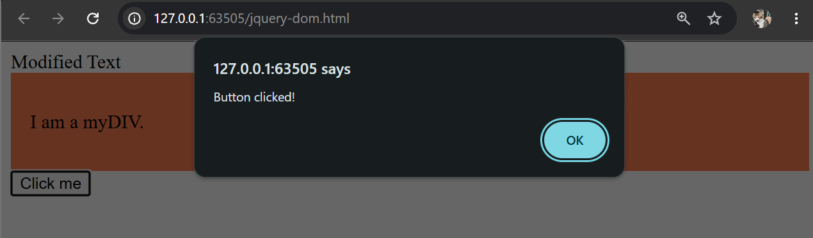

# BIC21203 Lab 4b: JSON and jQuery

- Course: BIC21203 Web Development (Session 2026/2027)
- Name: SEE RUI LONG
- Matric No: AI250206

## Project Files

| File | Description |
|------|-------------|
| `books.json` | Valid JSON dataset with a top-level `books` array (Q1) |
| `books.html` | Reads `books.json` with `fetch()` and displays the data on the page (Q2) |
| `jquery-dom.html` | jQuery 4.0.0 versions of three native JavaScript operations (Q3) |

## Setup Instructions

### Requirements
- A modern browser (Chrome / Edge / Firefox)
- Visual Studio Code with the **Live Server** extension
- Internet connection (for the jQuery CDN in Q3)

### Steps
1. Clone or download this repository:
   `git clone https://github.com/[你的用户名]/bic21203-lab4b.git`
2. Open the folder in VS Code.
3. For Q1 and Q2: right-click `books.html` and choose **Open with Live Server**.
   Do not open it with `file://`, because `fetch()` cannot load local files that way.
4. For Q3: open `jquery-dom.html` in the browser (or with Live Server).

## Screenshots

### Q1: books.json

The file is valid JSON and parses successfully.

### Q2: books.html output

The page shows the first book's title, the second book's author, and the genres grouped by book title.

### Q3: jquery-dom.html

`.text()` changes the text, `.addClass()` adds the `myStyle` class, and `.on("click", ...)` shows the alert when the button is clicked.